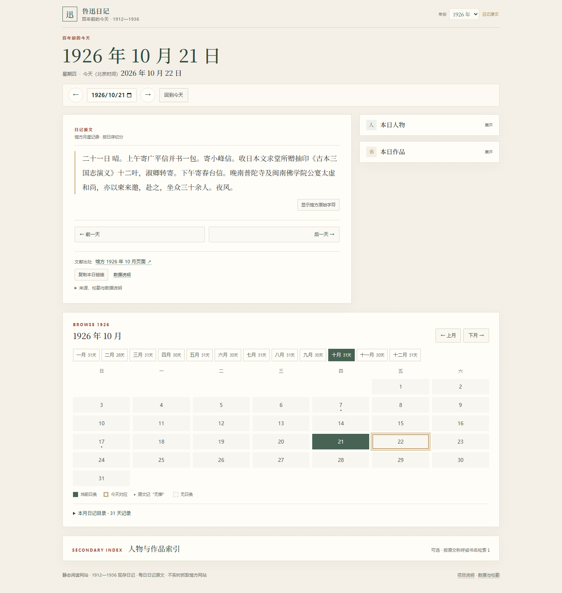
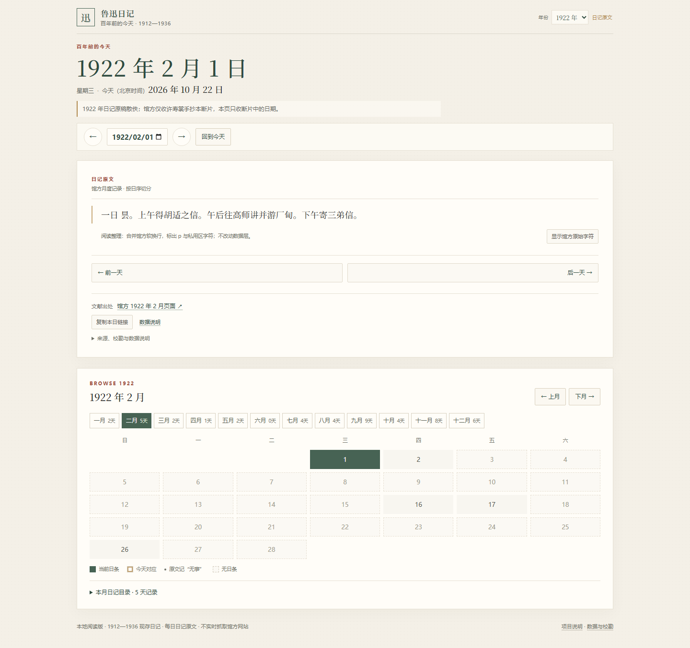
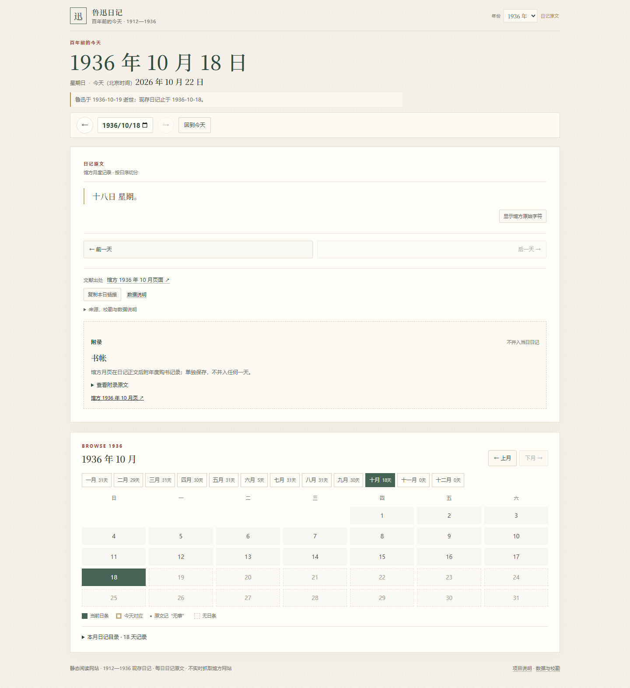

# 鲁迅日记·百年前的今天

**Lu Xun Diary · A Century Ago Today**

每天读一段鲁迅一百年前写下的日记原文。

## 在线阅读

`https://blueandnight.github.io/luxun-diary/`

GitHub Pages 已部署，完整日记数据已包含在本仓库。

## 项目简介

《鲁迅日记·百年前的今天》是一个以阅读原文为中心的数字文献展示项目：默认按北京时间找到一百年前的今天，展示鲁迅当天日记原文，并支持按年份、月份、日历和日期浏览。

项目只做原文阅读，不提供 AI 概述、白话翻译或历史解读。缺失日、原稿散佚和来源缺日会明确说明，不用相邻日期替代。

## 项目功能

- 默认展示“百年前的今天”
- 年份选择、跨年浏览、月份标签、日历和日期输入
- 前后日导航与日期深链，例如 `#d=1926-10-21`
- 缺失日、来源缺日和覆盖范围外日期的明确状态
- 1926 年人物/作品索引
- 纯静态 HTML/CSS/JavaScript；无后端、无数据库、无第三方运行时依赖

## 界面截图

<p align="center">
  
</p>

<p align="center"><em>首屏：历史日期、当天原文与前后日导航</em></p>

<p align="center">
  
</p>

<p align="center"><em>1922 年原稿散佚，只展示幸存的手抄本断片状态</em></p>

<p align="center">
  
</p>

<p align="center"><em>1936 年 10 月 18 日最后一条日条；年度书帐独立为附录</em></p>

## 收录范围

| 项目 | 数量 |
|---|---:|
| 年份 | 25（1912—1936） |
| 日条 | 8,589 |
| 完整年份 | 21 |
| 部分年份 | 4（1912、1922、1932、1936） |
| 附录 | 23 |

四个部分年份：

- **1912**：现存《壬子日记》始于 1912-05-05，共 241 条。
- **1922**：原稿散佚，仅存许寿裳手抄本断片 47 条；无 6 月等月份，不虚构全年。
- **1932**：馆方月页缺 1932-01-31，保留缺口。
- **1936**：现存日记止于 1936-10-18；6 月 6—30 日为来源连续缺日。

## 技术实现

- 纯静态 HTML/CSS/JavaScript
- 无构建工具、无 npm 依赖、无后端
- 按年份懒加载 JSON 数据
- 所有资源使用相对路径，直接部署在 GitHub Pages 的 `/luxun-diary/` 子路径下
- 不调用第三方 API；外部链接仅为馆方资料页面

```text
index.html
styles.css
app.js
quote.js
data/
└─ years/
   ├─ index.json
   ├─ 1912.json
   └─ … 1936.json
screenshots/
```

## 本地运行

```bash
python -m http.server
```

打开终端输出的本地 URL。

## 史料来源

主来源是北京鲁迅博物馆（北京新文化运动纪念馆）资料查询在线检索系统：

- 年份目录：`http://www.luxunmuseum.com.cn/cx/works.php?lid={year}&tid=3`
- 月度正文：`http://www.luxunmuseum.com.cn/cx/content.php?id={record_id}&tid=3&bt={year}`

每条日条保留馆方 `record_id`、正文 URL、月份记录与引用范围。公开仓库不含馆方原始 HTML 快照。

## 已知局限与数据权利

- **数字转录的公开再分发授权尚未确认**。馆方日记文本、页面内容和数据库权利归原权利人所有；本仓库公开数据由维护者决定并自行承担相应权利风险，不表示已经取得馆方书面授权。
- 除 1926 年外，未逐日与第二来源全文对校；未做纸本、影印本或手稿校勘。
- 1912 年前段、1922 年缺失月份、1932-01-31、1936 年 6 月 6—30 日等缺口均为来源状态，不补写。
- 若相关权利人提出异议，维护者应调整或移除相应内容。

## 许可

- **程序代码、HTML、CSS、JavaScript 和项目文档**：MIT License，见 [LICENSE](LICENSE)。
- **日记转录数据**：不适用 MIT，不随代码授予任何开放许可；详见 [DATA_NOTICE.md](DATA_NOTICE.md)。

## AI 辅助开发说明

本项目在开发过程中使用 **DeepSeek Harness（deepseek-flash）** 辅助代码编写、数据解析、边界验证和文档整理。

- 日记正文全部来自馆方网页转录，不是 AI 生成或改写。
- 缺失日、断片和来源缺口没有被 AI 推测填补。
- 没有使用 AI 生成页面概述、历史解读或人物知识图谱。
